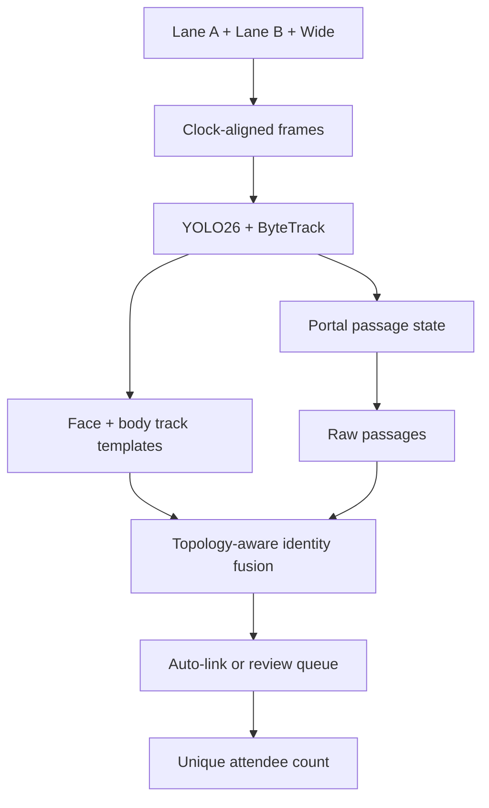

# Ingress Event Intelligence v4

An event-scale passage counter and deduplication system for two flowing entry lanes under one tent. It records every physical passage first, then resolves repeat attendees across Lane A, Lane B, and a shared wide camera using temporal, topology, face-template, and body-template evidence.

The old frame-level matcher is preserved at the repository root for reference. v4 is the new default system.

## What is working

- **One passage, one event:** a hysteretic portal state machine emits a passage only after a stable directional line crossing.
- **Track-level evidence:** face and body embeddings are aggregated across the best frames in a tracklet instead of trusting one frame.
- **Explainable identity fusion:** a calibrated logistic layer combines face, body, quality, time, topology, candidate margin, and hard impossible-overlap constraints.
- **Human-in-the-loop review:** ambiguous links enter a small reversible disagreement queue; decisions are recorded in an event-scoped audit trail.
- **Event Rehearsal Lab:** synchronized playback, model-run comparison, ground-truth error, false merges/splits, passage recall, review load, camera health, and model divergence.
- **YOLO26 adapter:** Ultralytics YOLO26 + ByteTrack support is available through the `vision` extra. InsightFace receives OpenCV BGR frames correctly.
- **Temporary-by-construction storage:** every record and file is scoped to an event. Purge uses an exact confirmation, SQLite secure-delete, WAL truncation, vacuuming, and a bounded event directory.
- **Deterministic operation:** video manifests include SHA-256 hashes so the same three source files and model bundle produce a comparable rehearsal run.

## Checking the live count against the truth

With `"activity_capture": true` in the camera file, the station saves a short
two-camera strip of every active moment at the door. Open
`http://127.0.0.1:18046/api/live/review` through the preview tunnel, say how many
people really went in and out, and read the result at `/api/live/scorecard` or
with `.venv/bin/ingress scorecard <event-id>`. See
`docs/activity-scorecard-2026-11-18.md`.

## Start it

From the repository root:

```bash
./start_all.sh
```

That creates the local Python environment, builds the command center, seeds a deterministic rehearsal, and serves the app and API from one process.

For the optional real vision stack:

```bash
./start_all.sh --vision
```

Useful developer commands:

```bash
cd v4
.venv/bin/pytest
.venv/bin/ruff check backend tests
cd web && npm run build && npm run test:sites
```

## Booth Mac preview over Tailscale

The recording Mac is `booth2@100.82.19.48` (`edith-5.local`). Its SSH host key
matches the original `192.168.1.46` entry. From the viewing Mac, run
`./start_preview_tunnel.sh` in the repository root to forward the live camera to
`http://127.0.0.1:18046/live` and the recording replay to
`http://127.0.0.1:18047/live`. The script uses SSH authentication and stores no
password. The replay binds to remote loopback port 18147; port 8001 belongs to Supabase and must not be reused. Both services must already be running on the recording Mac. Do not
start a second tunnel while those local ports are in use.

## Paired recorded-camera rehearsal

`paired_replay` selects `PairedSession`. Exactly two views (`front`, `side`) carry
strictly increasing `{frame, clock}` indexes that cover the shared excerpt.
The views have independent trackers and face registries. Only the side view
counts passages. Accepted evidence feeds a combined registry without suppressing
local recognition. Parent-event deletion also removes camera-control databases.

The verified replay configuration is `data/paired-audit/verified-preview.json`.
`start_replay.sh` prefers this configuration when available. The plan's
`appearance_matching` enables local OSNet descriptors and repeated, one-to-one
cross-view matching. `appearance_weights` supplies author-released MSMT17 weights.
Optional `observation_cache` and `appearance_cache` replay previously computed
observations; caches are checked against source files and the detector checksum.
`playback_speed` affects only recording replay, never model evidence counts.

`front_to_side: null` intentionally disables precise geometric projection. The
attempted calibration failed validation; do not describe that path as complete.
The enabled appearance linker is a different method and has a small reviewed
candidate evaluation, not a production accuracy guarantee. See
`data/paired-audit/verified-work-report.md` for the 18-case review, held-out results,
accepted profile consolidation, and remaining 21 unresolved entry crossings.

The vendored OSNet architecture is from KaiyangZhou/deep-person-reid under MIT
(`backend/ingress/vision/OSNET_LICENSE`). Weights are downloaded from the author's
https://huggingface.co/kaiyangzhou/osnet repository. Model files and biometric
observation caches stay in ignored, private local data/model directories.

## Single-camera live test

Run `./start_live.sh` from the repository root and open
[the live test](http://127.0.0.1:8000/live). Python 3.11, npm, and either uv or pip
are required. This installs the `live` extra, uses YOLO26s + ByteTrack for bodies,
and InsightFace buffalo_l / ArcFace for face detection and recognition. Model
weights download on first use if not already installed.

The private file `v4/data/camera-local.json` supplies `host`, `username`,
`password`, `channel` (usually `101`), and optional `model`. Keep it mode `0600`;
`v4/data/` is excluded from git. Credentials are never returned by the API.
The stream path follows [ANNKE's RTSP documentation](https://help.annke.com/hc/en-us/articles/4406871916825-ANNKE-VISION-How-to-Set-Up-RTSP-for-Your-Device-on-VLC-Player).

The live test uses a separate database at `v4/data/live-test`, disables demo
seeding, and binds only to this Mac's loopback interface. Live frames stay in
memory; passage records, line calibration, and event-scoped face templates persist
across restarts. It does not send notifications. Accepted face thumbnails are saved locally with the event and survive restarts. Event purge removes them along with the face templates.
Only the detection and recognition modules run; no age or gender models run.

Three consistent, sufficiently clear face samples enroll an anonymous visitor.
Smaller frontal faces require six agreeing observations, confident landmarks,
and a minimum native width of 40 pixels. Their match threshold is higher (0.68),
their candidate margin is wider (0.12), and new-profile separation is stricter
(below 0.25). This does not recover detail missing from a recording.
For high-quality samples, similarity >= 0.60 with a >= 0.08 margin matches;
similarity < 0.35 permits a new face. The middle band and
simultaneous overlapping identity assignments remain unresolved. These are
provisional test thresholds, not measured event accuracy or calibrated probabilities.
Recognition does not merge the old crossing-only records without face evidence.

- **Face profiles:** model-enrolled identities, not a verified distinct-person tally.
- **Face-linked entrants:** distinct matched profiles with an entry crossing.
- **Repeat entries:** matched entry crossings beyond each identity's first entry.
- **Unresolved entries:** entry crossings without a usable identity match.

A clear face up to ten seconds after a crossing can resolve that same continuous
track's pending passage. A single inconsistent observation does not erase a track's
history; enrollment requires a dominant consistent cluster. Confirmed identities
survive weak poses on a continuous body track, while contradictory faces quarantine
crossings until a new consensus is available. Short ID handoffs require unambiguous
geometry and appearance agreement, with simultaneous tracks excluded.
The body detector retains low-confidence recovery observations, but ByteTrack
requires a higher score to create a new track. Reconnects and live-camera pauses
discard track state, while saved
templates allow recognition again. Event purge includes the face template table.
Face tracklets accumulate observations independently of body detections. Clear
one-to-one body associations link those observations to passages; temporary body
occlusion does not discard readable face samples or prevent later entry resolution.

For overhead views, `require_body_motion` corroborates a footpoint crossing with
directional upper-body movement. It filters box-height jitter without changing the
line. It is optional because camera angle changes projected body motion. Recorded
view calibration is saved into its source plan and survives a fresh replay.
Model licensing must be checked before commercial deployment; the supplied
buffalo_l pretrained weights are provided for non-commercial research/testing.

Open `/live`, position the orange line across the walking path, apply the line,
and face the camera until a visitor label appears. Enter, leave, and re-enter:
expect one unique entrant, two entries, and one repeat entry with the same label.
Verify this with two different people, turned-away faces, and a restart.
The camera should show each person's entire body, including feet. Track fragmentation,
occlusion, and face-match errors can still cause missed or extra counts.
Counts pause on missing footage, and reconnects discard old tracking state.
Stop with Ctrl+C. Stop the live process before using the existing event purge API.

The live API exposes `/api/live/status`, `/api/live/frame.jpg`,
`PUT /api/live/calibration`, and `POST /api/live/control` with `{"paused": true}`.

## Motion-triggered doorway replay

[See the crowded Fair benchmark](docs/crowded-fair-benchmark.md) for per-person detector comparisons, interrupted-track cases and the optional corroborated handoff replay.

The offline gate audit uses three strips of pixels to identify moments for full-rate detection and shows each window as a photo finish. On the recorded booth walkthrough, adaptive sampling recovered both entries missed by an evenly spaced 498-frame control. [Experiment and reproduction commands](docs/gate-motion-replay.md)

## Turn last year's video into the advantage

### Recorded-camera excerpts

Set `INGRESS_LIVE_CAMERA_FILE` to a JSON recording plan instead of camera credentials.
The plan has `playback_speed` and a `replay_clips` list. Each clip specifies `path`,
`label`, `camera` (a slug), `station`, `start_seconds`, `duration_seconds` (maximum
600), and optional normalized line `calibration`. Start the normal `ingress serve`
process with its own `INGRESS_DATA_ROOT` and port, then open `/live`.

RecordedSession feeds those frames through the same recognition worker. It retains
native resolution for face evidence, paces by encoded FPS with backpressure,
processes every decoded frame, resets tracking between
sources, and shares event face templates between the selected station views.
It is a sequential excerpt test, not synchronized multi-camera playback.
Playback slows when recognition cannot keep up. Tracking, sampling, and delayed
face links use video time rather than CPU/wall-clock delays. This makes replay
comparisons meaningful; a skipped-frame run must not be treated as the same input.
Every launch or **Start a fresh replay** creates a new event/run. Pausing pauses
the recording, and end-of-file produces a labeled final frame rather than silently
looping and double-counting. The completed report is saved under
`data-root/events/<run-id>/replay-report.json`.

`tools/audit_recordings.py` makes a three-frame-per-file visual catalog and samples
crowd density. `tools/rename_recordings.py` applies station naming with preflight
collision checks, source fingerprints, and a reversible rename journal. Unreadable
files and uncertain station assignments must be retained and labeled explicitly.

### Historical-video workflow

1. Put the three synchronized recordings somewhere outside the repository.
2. Create an immutable replay manifest:

   ```bash
   cd v4
   .venv/bin/ingress manifest \
     --event harvest-2025 \
     --camera lane-a=/recordings/lane-a.mp4 \
     --camera lane-b=/recordings/lane-b.mp4 \
     --camera wide=/recordings/wide.mp4 \
     --output data/events/harvest-2025/manifest.json
   ```

3. Replay the recordings to generate tracklets and a disagreement queue. Review ambiguous pairs in the command center instead of labeling every frame.
4. Export reviewed pairs as CSV and fit the event-domain fusion layer:

   ```bash
   .venv/bin/ingress train-fusion \
     --labels data/events/harvest-2025/reviewed-pairs.csv \
     --output data/events/harvest-2025/fusion-model.json
   ```

5. Compare the candidate run against a held-out time block. Ship only when unique-count error, false merges, false splits, passage recall, and review minutes all pass the event gate.

Do not fine-tune on random frames from the same track and test on adjacent frames; that leaks identity and lighting. Split by time block or entire tracklet. The fusion trainer applies a five-times penalty to false merges because collapsing two people is the most damaging error for a unique-attendee count.

## Runtime architecture



Raw passages are never hidden by deduplication. The operational count is reproducible from passages plus identity-link decisions.

## API surface

| Endpoint | Purpose |
|---|---|
| `GET /api/events/{id}/summary` | Event count, progress, camera state, active run |
| `GET /api/events/{id}/timeline` | Passage, health, and model-divergence samples |
| `GET /api/events/{id}/replay-runs` | Comparable model bundles and error metrics |
| `POST /api/events/{id}/replay/control` | Play, pause, seek, and replay speed |
| `GET /api/events/{id}/candidates` | Ambiguous identity links |
| `POST /api/events/{id}/candidates/{candidate}/decision` | Reversible operator judgment |
| `PUT /api/events/{id}/cameras/{camera}/calibration` | Normalized approach zone and commit line |
| `GET /api/events/{id}/purge-plan` | Exact records, directory, bytes, and confirmation phrase |
| `POST /api/events/{id}/purge` | Secure event-scoped deletion |
| `WS /api/events/{id}/stream` | Live summary stream |

Interactive OpenAPI documentation is served at `/api/docs`.

## Storage contract

The event ID is the isolation boundary. Database foreign keys cascade from `events`; recordings and derived artifacts live only under `data/events/<event-id>`. A purge rejects unbounded paths, removes the event directory, deletes all event rows including the temporary audit trail, enables SQLite `secure_delete`, truncates the WAL, and vacuums free pages.

The command center exposes the plan before deletion and requires the exact phrase `PURGE <event-id>`.

## Honest limits

The included fixture demonstrates the product and API contract; its displayed accuracy is not a claim about a new event. Real accuracy must be measured on the provided historical video after camera clocks and portal geometry are calibrated. Face evidence should remain one signal in the fusion model—occlusion, lighting, pose, and crowd density make a single biometric threshold brittle.

### Live front and side station

A private camera JSON may include a `facing_camera` object with its own `host`,
`username`, `password`, `channel`, and `model`. The top-level camera is the side
view: it alone records crossings and displays the calibration line. The facing
view recognizes faces without a counting line. Both views share face templates
and previews, while track state remains separate. Crossings with no accepted
face evidence remain unresolved; timestamps alone do not establish identity.

`"association_zone"` adds position evidence to the link between the two views:
`"off"` (default), `"shadow"` (learn, decide and record on every crossing, but
assign nothing) or `"on"`. It needs `association_overlap_seconds`. See
`docs/cross-view-position-2026-11-17.md`.

RTSP decoding runs in separate processes with credentials supplied through
stdin. A decoder that stops producing frames for ten seconds is replaced;
reconnection resets crossing state to avoid counting a jump across the line.
The preview reports each view's freshness and only marks the station live when
both views are live. On Edith, `com.ingress.single-camera-test` is a login launch
agent with automatic process restart. Existing event counts and templates are
preserved. Test an actual enter/leave/re-enter sequence after camera placement
or side-line calibration changes.

## YOLO26m with a live RF-DETR second look

Set the launch service's `INGRESS_LIVE_MODEL` to an explicit local YOLO26m weights file.
Set `tracker_name` to `crowd-consensus` on each participating camera. Set the counting
camera's `second_look_model` to an absolute path to the static RF-DETR-Large 704px ONNX
export. Produce that export on a development machine with the official RF-DETR package
and `RFDETRLarge(device="cpu").export(format="onnx", output_dir="models")`.
The booth uses its existing ONNX Runtime CPU provider for the second look.

YOLO processes each selected live frame. RF-DETR checks the same frame during gate
motion, crowded scenes, a drop in visible detections, and periodically when the scene
is quiet. It proposes additional boxes and can strengthen a weak primary observation.
RF scores below 0.50 require a second observation within 1.2 seconds and retain their
original score. Each accepted box goes through the normal tracker and crossing
confirmation. TrackTrack, ByteTrack and OC-SORT share one detector pass for the
corroborated handoff mode.

Each view reports the detector filename, tracking mode and cumulative corroborated
handoffs under `runtime` on `/api/live/status`. The counting view also reports RF
inferences, errors, extra boxes, corroborated low scores and duration of the last
RF pass. Replay the same path with `tools/benchmark_live_models.py --tracker
crowd-consensus --second-look-model /path/to/rfdetr-large.onnx` and the standard
recording, model, timestamp and gate arguments.
